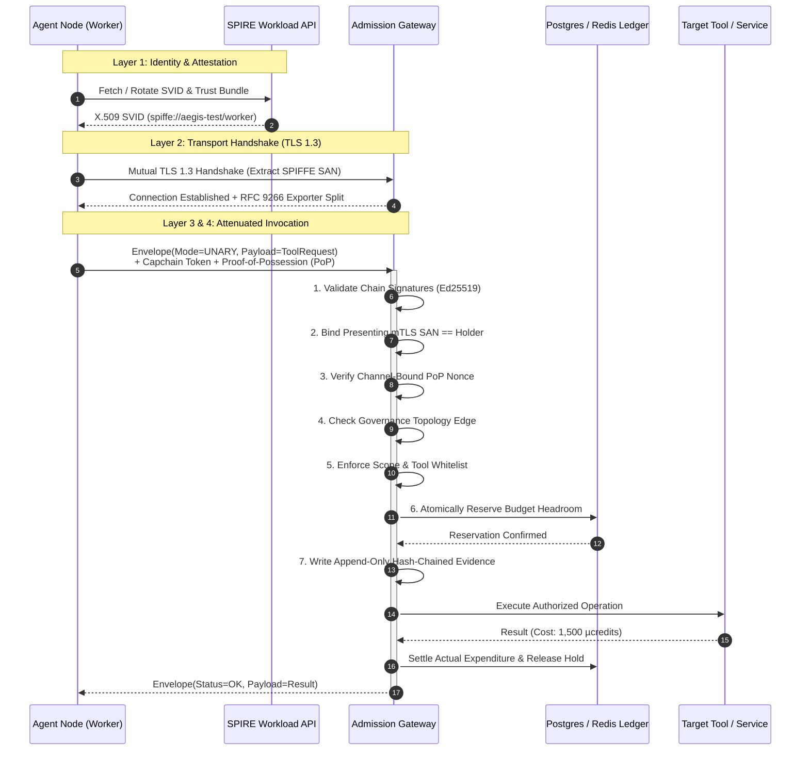

# 🛡️ AEGIS

<div align="center">

[](https://www.python.org/)
[](https://spiffe.io/)
[](https://tools.ietf.org/html/rfc8446)
[](https://github.com/astral-sh/ruff)
[](https://mypy.readthedocs.io/)
[](https://github.com/astral-sh/uv)

**A Cryptographic, Zero-Trust Capability & Attested Transport Fabric for Autonomous Multi-Agent Networks**

[Architecture](#-architecture) •
[Core Innovations](#-core-innovations) •
[Threat Model](#-threat-model--adversary-matrix) •
[Quick Start](#-quick-start) •
[CLI & Governance](#-governance--cluster-operations) •
[Wire Protocol](#-wire-protocol--transport-stack) •
[Verification](#-testing--verification)

</div>

---

## 📌 Overview

**Aegis** is an enterprise-grade, zero-ambient-authority security fabric designed specifically for distributed, multi-agent AI ecosystems and high-assurance microservices.

In modern multi-agent systems, agents dynamically delegate work, query tools, and invoke downstream services on behalf of users. Traditional perimeter security, bearer API tokens, and static IAM credentials completely break down in this environment:
* **Prompt Injection & Confused Deputy Attacks:** A compromised worker agent can abuse broad ambient API keys or re-delegate authority without restriction.
* **Token Exfiltration & Replay:** Intercepted bearer tokens can be used out of context, across connections, or after task completion.
* **Runaway Resource Exhaustion:** Agents lack granular, verifiable budget ceilings and sub-delegation limits.

**Aegis solves this at the protocol level.** Every interaction is anchored in hardware-attested SPIFFE identities, carried over fail-closed TLS 1.3 channels with directional key exporter separation, and authorized through **Capchain**—an append-only, mathematically attenuated cryptographic capability token signed by Ed25519 keys with per-request Proof-of-Possession (PoP).

---

## 🏛 Architecture

Aegis enforces a 5-layer fail-closed stack where no layer trusts unverified input from the layer below:

```
┌──────────────────────────────────────────────────────────────────────────────┐
│  Layer 5: Application & Services                                             │
│    Orchestrator • Worker • LLM-Gateway • Tool Gateways                       │
├──────────────────────────────────────────────────────────────────────────────┤
│  Layer 4: Capability & Admission Control (libs/capchain)                     │
│    Capchain tokens (Ed25519) • PoP • Budget Ledger • Audit Evidence Log       │
├──────────────────────────────────────────────────────────────────────────────┤
│  Layer 3: Hardened Wire Protocol & Messaging (libs/proto)                     │
│    Envelope Framing (6B prefix + TLV) • Anti-bomb Codecs (JSON/CBOR) • Status │
├──────────────────────────────────────────────────────────────────────────────┤
│  Layer 2: Fail-Closed Transport Fabric (libs/transport)                       │
│    Stream Multiplexing • Bounded Frames • TLS 1.3 mTLS • Exporter HKDF Split │
├──────────────────────────────────────────────────────────────────────────────┤
│  Layer 1: Identity & Attestation (libs/agentid & SPIFFE/SPIRE)                │
│    Hardware/Node x509pop • SVID X.509 Rotation • Zero-Downtime Socket Watchers│
└──────────────────────────────────────────────────────────────────────────────┘
```

### End-to-End Request Flow



---

## ⚡ Core Innovations

### 1. Cryptographic Capability Chains (`libs/capchain/`)
* **Mathematical Attenuation:** Any workload can sub-delegate a token to downstream agents, but it can **only narrow authority** (reduce remaining budget, shorten TTL, restrict tool whitelist, or decrement max delegation depth). Widening authority causes mathematical verification failure.
* **Proof-of-Possession (PoP):** In `KEY_BOUND` mode, tokens are useless if intercepted. The caller must produce a cryptographic signature using its private key bound to the specific TLS channel (RFC 9266 exporter binding) and a fresh, single-use nonce.
* **Dual-Store Architecture (`libs/capchain/checkpoint.py`):**
  * **Redis:** High-throughput ephemeral nonces, replay cache, and revocation lists.
  * **PostgreSQL:** ACID transactional budget ledgers and append-only cryptographic evidence logs.

### 2. Directional Exporter Separation (`libs/transport/tls.py`)
* Enforces **TLS 1.3 only** (TLS 1.2 is explicitly rejected to eliminate extended-master-secret renegotiation bugs).
* Derives session secrets via RFC 9266 TLS Keying Material Exporters, splitting secrets with **HKDF-SHA256** into directional stream MACs and channel-binding tags. A compromised or reflected stream cannot replay our own chunks back at us.

### 3. Fail-Closed Transport & Multiplexing (`libs/transport/`)
* **Bounded Frame Reader (`frame.py`):** Length-prefixed framing with strict limits. Any peer attempting to send frames exceeding negotiated size is dropped immediately before allocating memory.
* **Async Stream Multiplexing (`stream_session.py`):** Full bidirectional multiplexing over a single authenticated mTLS connection, featuring window-based byte-level backpressure, ping keepalives, and independent stream cancellation.

### 4. Zero-Downtime SPIFFE Identity Engine (`libs/agentid/`)
* Seamless integration with SPIRE agents via Unix Domain Sockets (`unix:///run/spire/sockets/agent.sock`).
* In-memory SVID rotation without dropping active server sockets or restarting workloads.
* Fail-closed peer verification enforcing exact SPIFFE URI SAN matching against authorized trust domains.

### 5. Weaponized Wire Codecs (`libs/proto/codec.py`)
* Strict enforcement of `CodecLimits`: maximum byte length, recursion depth, and item counts.
* **Bomb Protection:** Linear pre-scans defeat compression bombs, deeply nested JSON structures, and CBOR indefinite-length payloads before application deserialization.
* Rejection of `NaN`, `±Inf`, duplicate dictionary keys, and non-finite floats.

---

## 🔒 Threat Model & Adversary Matrix

Aegis is engineered against adversarial machine-to-machine environments:

| Adversary Class | Attack Vector | Aegis Defense Mechanism |
|---|---|---|
| **A1 — Passive Network Eavesdropper** | Intercepts in-flight network packets | Mandatory TLS 1.3 with forward secrecy; zero cleartext wire exposure. |
| **A2 — Token Exfiltration** | Steals capchain token from logs or memory dumps | In `KEY_BOUND` mode, tokens cannot be spent without the holder's Ed25519 private key (`cnf`). |
| **A3 — Proof Relay / Man-in-the-Middle** | Captures `(token, proof)` and replays on another connection | RFC 9266 Channel Binding binds the proof to the unique TLS exporter (`CB_MISMATCH`). |
| **A4 — Peer Impersonation** | Attacker connects with a rogue or mismatched certificate | Admission gateway validates the presenting X.509 SPIFFE SAN against the token holder (`WRONG_HOLDER`). |
| **A5 — Scope Probing / Oracle** | Floods gateway with exploratory requests to map permissions | Nonces are burned *before* policy checks; probing exhausts attacker nonces and rate limits. |
| **A6 — Delegation Escalation** | Agent attempts to widen tool scope or budget in child token | `attenuate()` and `verify_chain()` enforce mathematical subset containment (`SCOPE_EXPANSION`). |
| **A7 — Compromised Leaf Workload** | Workload process is completely hijacked | Sub-second revocation via `RevocationStore.revoke_agent()` and short token TTLs. |
| **A8 — Confused Deputy** | Upstream agent tricking a downstream service into executing unintended actions | Tokens are explicitly scoped with target audience, permitted tools, and strict budget ceilings. |

---

## 🚀 Quick Start

### Prerequisites
* **Python**: `3.11+`
* **Package Manager**: [`uv`](https://github.com/astral-sh/uv) (recommended)
* **Containers**: Docker & Docker Compose
* **Platform**: Linux, macOS, or Windows (WSL2/PowerShell)

### 1. Installation

Clone the repository and install dependencies using `uv`:

```bash
git clone https://github.com/aegis/aegis.git
cd aegis

# Synchronize virtual environment with uv
uv sync
```

### 2. Environment Configuration

Copy the example environment template:

```bash
cp .env.example .env
```

Ensure `.env` contains your PostgreSQL and Redis credentials:
```ini
REDIS_PASSWORD=aegis_super_secret_redis_pass
POSTGRES_USER=capchain
POSTGRES_PASSWORD=aegis_super_secret_pg_pass
POSTGRES_DB=capchain
TRUST_DOMAIN=spire.lab.acme
```

### 3. Bootstrap Governance & Cryptographic Roots

Aegis provides a built-in CLI (`aegis` or `python -m gov`) to bootstrap trust in seconds:

```bash
# 1. Generate cryptographic Ed25519 keypairs (authority, issuer, enrollment, agent keys)
uv run aegis gen-keys --dir keys --agents node-2

# 2. Initialize governance configuration (one-shot bootstrap)
uv run aegis init \
    --issuer-key     keys/issuer.pub \
    --issuer-spiffe  spiffe://spire.lab.acme/orchestrator \
    --enrollment-key keys/enrollment.pub \
    --not-before     2026-01-01T00:00:00Z \
    --expires-at     2026-04-01T00:00:00Z \
    --out            config/governance.toml

# 3. Add tool pricing (in microcredits)
uv run aegis add-pricing --tool compute:execute --base 1000
uv run aegis add-pricing --tool database:query   --base 500

# 4. Define permitted delegation edges in the agent topology
uv run aegis add-edge \
    --parent spiffe://spire.lab.acme/orchestrator \
    --child  spiffe://spire.lab.acme/worker \
    --max-ttl 3600 \
    --max-children 4 \
    --ceiling-tools "compute:execute,database:query" \
    --ceiling-budget 5000000 \
    --ceiling-audience spiffe://spire.lab.acme/gateway

# 5. Authorize initial token issuance policy
uv run aegis add-issuance \
    --holder spiffe://spire.lab.acme/worker \
    --ttl 600 \
    --max-depth 2 \
    --model key_bound \
    --scope-tools "compute:execute,database:query" \
    --scope-budget 1000000 \
    --scope-audience spiffe://spire.lab.acme/gateway

# 6. Validate topology and sign the cryptographic bundle
uv run aegis validate
uv run aegis sign --key keys/authority.seed --out config/governance.bundle
```

### 4. Start the Cluster with Docker Compose

Launch SPIRE server, SPIRE agent, Redis, Postgres, and the Aegis workloads:

```bash
# Generate node attestation certificates and prepare volumes
make certs
make volume

# Start the cluster
make up
```

Check attested agents and registration entries:
```bash
make status
make list
make entries
```

---

## 🛠 Governance & Cluster Operations

Aegis implements immutable, cryptographically signed governance. Node configs and topology rules are declared in `governance.toml`, compiled, and verified offline by an air-gapped authority key.

```
                  ┌──────────────────────┐
                  │   governance.toml    │
                  └──────────┬───────────┘
                             │
                     aegis validate
                             │
                  aegis sign (offline key)
                             │
                             ▼
                  ┌──────────────────────┐
                  │  governance.bundle   │  (Ed25519 signed)
                  └──────────┬───────────┘
            ┌────────────────┴────────────────┐
            ▼                                 ▼
   ┌─────────────────┐               ┌─────────────────┐
   │ Admission Node  │               │ Workload Node   │
   │ (node-gw.toml)  │               │ (node-w1.toml)  │
   └─────────────────┘               └─────────────────┘
```

### CLI Command Reference

| Command | Description |
|---|---|
| `aegis gen-keys --dir <dir> --agents <names>` | Generate Ed25519 root authority, issuer, and agent workload keys |
| `aegis init` | Create a fresh `governance.toml` definition |
| `aegis add-edge / remove-edge` | Manage allowed delegation edges in the authority graph |
| `aegis add-issuance / remove-issuance` | Configure initial token issuance bounds and ceilings |
| `aegis add-pricing / remove-pricing` | Define or update per-tool microcredit pricing rules |
| `aegis validate` | Perform comprehensive compile-time policy and topology validation |
| `aegis sign --key <authority.seed>` | Cryptographically sign the governance bundle |
| `aegis gen-node --name <name> --role <role>` | Generate a ready-to-run per-node TOML configuration |
| `aegis show` | Print human-readable summary of governance rules |

---

## 📡 Wire Protocol & Transport Stack

### Envelope Framing (`libs/proto/envelope.py`)

All messages between agents and gateways are wrapped in a 6-byte packed prefix followed by TLV-encoded headers and a bounded payload:

```
 0                   1                   2                   3
 0 1 2 3 4 5 6 7 8 9 0 1 2 3 4 5 6 7 8 9 0 1 2 3 4 5 6 7 8 9 0 1
+-+-+-+-+-+-+-+-+-+-+-+-+-+-+-+-+-+-+-+-+-+-+-+-+-+-+-+-+-+-+-+-+
|  Version (1B) |   Type (1B)   |   Flags (1B)  | Reserved (1B) |
+-+-+-+-+-+-+-+-+-+-+-+-+-+-+-+-+-+-+-+-+-+-+-+-+-+-+-+-+-+-+-+-+
|          Header Length (u16)  |    Payload ...                |
+-+-+-+-+-+-+-+-+-+-+-+-+-+-+-+-+-+-+-+-+-+-+-+-+-+-+-+-+-+-+-+-+
|       TLV Headers (Tagged, Length-prefixed metadata)          |
+-+-+-+-+-+-+-+-+-+-+-+-+-+-+-+-+-+-+-+-+-+-+-+-+-+-+-+-+-+-+-+-+
|       Bounded Payload (JSON, CBOR, or Raw Bytes)              |
+-+-+-+-+-+-+-+-+-+-+-+-+-+-+-+-+-+-+-+-+-+-+-+-+-+-+-+-+-+-+-+-+
```

### Supported Channel Communication Modes

| Mode | Enum ID | Semantics |
|---|---|---|
| `UNARY` | `0x01` | Single request followed by a single response. |
| `CLIENT_STREAM` | `0x02` | Multiple request frames terminated by `END`, single response. |
| `SERVER_STREAM` | `0x03` | Single request, streaming response frames terminated by `END`. |
| `BIDI` | `0x04` | Full duplex asynchronous stream over one transport channel. |
| `DATAGRAM` | `0x05` | Fire-and-forget message without delivery guarantee. |

---

## 💻 Developer Guide: Using Aegis in Python

### Creating and Attenuating a Capchain Token

```python
import time
from cryptography.hazmat.primitives.asymmetric.ed25519 import Ed25519PrivateKey
import libs.capchain.capchain as cc

# 1. Issuer mints root token for Worker
issuer_key = Ed25519PrivateKey.generate()
worker_key = Ed25519PrivateKey.generate()

root_token = cc.issue_root(
    issuer_key=issuer_key,
    issuer_id="spiffe://spire.lab.acme/orchestrator",
    holder_id="spiffe://spire.lab.acme/worker",
    model=cc.Model.KEY_BOUND,
    cnf_pub=worker_key.public_key(),
    audience="spiffe://spire.lab.acme/gateway",
    tools=["compute:execute", "database:query"],
    budget_micros=1_000_000,
    ttl_seconds=3600,
    max_depth=3,
)

# 2. Worker sub-delegates to a Sub-Worker with attenuated privileges
subworker_key = Ed25519PrivateKey.generate()

child_token = cc.attenuate(
    parent_token=root_token,
    parent_key=worker_key,
    new_holder="spiffe://spire.lab.acme/subworker",
    cnf_pub=subworker_key.public_key(),
    # Attenuations: narrower scope, lower budget, shorter TTL
    tools=["database:query"],
    budget_micros=100_000,
    ttl_seconds=300,
)
```

### Dispatching an Authorized Call Through Admission Gateway

```python
import libs.capchain.gateway as gw

# 1. Initialize Gateway with verified roots & stores
gateway = gw.Gateway(config=gw_config)

# 2. Perform admission verification before executing side effects
async with gateway.admit(
    token=child_token,
    pop_proof=pop_signature,
    peer_id="spiffe://spire.lab.acme/subworker",
    requested_tool="database:query",
    estimated_cost=500,
) as permit:
    # 3. Side effect execution (budget held, evidence chained)
    result = await permit.execute(
        lambda: database_service.query("SELECT * FROM metrics"),
        settle=lambda res: 450,  # Settle actual cost
    )
```

---

## 🧪 Testing & Verification

Aegis is validated through a rigorous testing pyramid encompassing property-based hypothesis tests, unit suites, and containerized integration topologies:

```bash
# Run unit test suite
uv run pytest tests/unit -v

# Run protocol framing and codec tests
uv run pytest tests/unit/proto -v

# Run Capchain mathematical attenuation tests
uv run pytest tests/unit/test_capchain.py -v

# Run static analysis and linting
uv run ruff check .
uv run mypy libs aegis cli
```

---

## 📂 Repository Layout

```
aegis/
├── aegis/                     # Containerized microservice definitions
│   ├── services/
│   │   ├── orchestrator/      # Top-level coordinator workload
│   │   ├── worker/            # Execution worker agent
│   │   ├── tools/             # Sandboxed tool server
│   │   └── llm-gateway/       # Budget-governed model inference gateway
│   └── clock.py               # Monotonic time reference
├── cli/                       # Production agent control CLI
│   └── agentctl/              # `aegis` command implementation
├── config/                    # Cluster governance & node configurations
├── deploy/                    # Deployment profiles (SPIRE server/agent configs)
├── docs/                      # In-depth engineering specifications
│   ├── capchain.md            # Complete Capchain v2 protocol specification
│   └── transport.md           # Transport v4 layer specification
├── libs/                      # Core cryptographic & protocol libraries
│   ├── agentid/               # Zero-downtime SPIFFE identity & SVID manager
│   ├── capchain/              # Capability chains, gateway & checkpoint stores
│   ├── proto/                 # Envelopes, TLVs, codecs (CBOR/JSON), channels
│   └── transport/             # TLS 1.3, exporter split, stream multiplexer
├── scripts/                   # PKI and SPIRE cluster lifecycle automation
├── tests/                     # Unit, integration, and property-based test suites
├── docker-compose.yml         # Dev cluster definition (SPIRE, Postgres, Redis)
├── Dockerfile                 # Multi-stage container builds
├── gov.py                     # Standalone cluster governance tool
├── Makefile                   # Cluster lifecycle shortcuts
└── pyproject.toml             # uv workspace and dependency configuration
```

---

## 📄 License & Compliance

Licensed under the [Apache License 2.0](LICENSE). Designed in accordance with **RFC 9266** (Channel Binding), **RFC 8446** (TLS 1.3), **SPIFFE/SPIRE Standards**, and **Ed25519 (RFC 8032)**.
